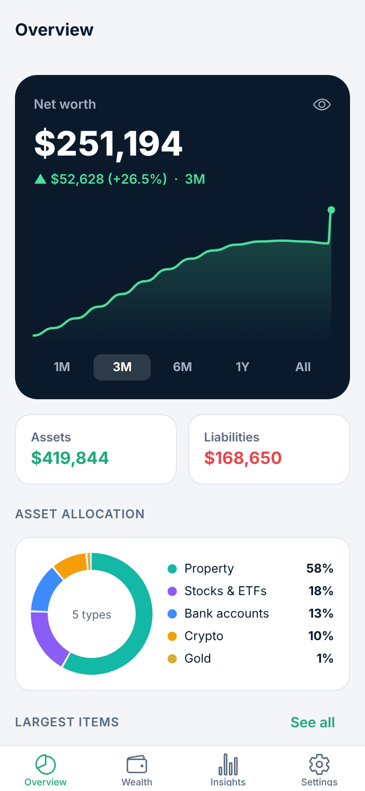
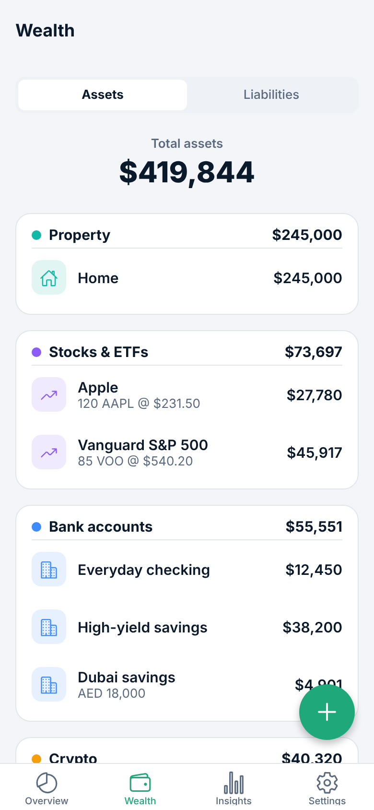
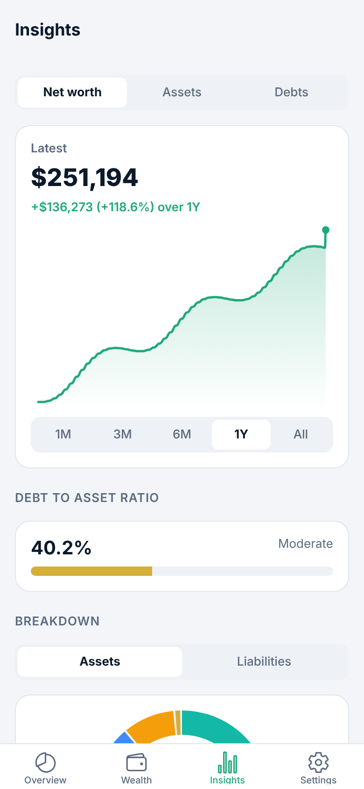
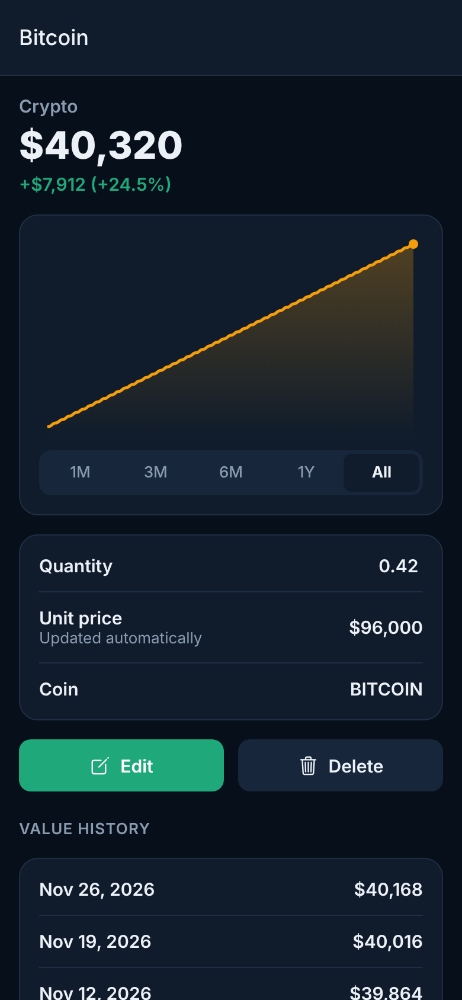

# GuardBox

A private personal wealth tracker: see your net worth, assets and liabilities in one place, in any currency, locked behind Face ID.

Built with **React Native + Expo (SDK 58) + TypeScript**, so the same code runs on iPhone now and Android later.

| Overview | Wealth | Insights | Item (dark) |
|---|---|---|---|
|  |  |  |  |

## Features

- **Net worth dashboard** with a scrubbable chart (1M / 3M / 6M / 1Y / All), change over the period, asset allocation donut and largest items.
- **Assets and liabilities**: cash, bank accounts, stocks & ETFs, crypto, property, gold, vehicles, loans, mortgage, credit cards, plus your own **custom categories** (name, colour, icon, and how they are valued).
- **History**: every value change is kept per item and as a daily net-worth snapshot, so charts build up over time.
- **Multiple currencies**: each item has its own currency; totals are converted to your main currency with daily exchange rates.
- **Free live prices** (no paid APIs):
  | Type | Source | Key needed |
  |---|---|---|
  | Crypto | CoinGecko public API | No (optional free demo key) |
  | Gold | gold-api.com, fallback CoinGecko PAX Gold (1 token = 1 oz) | No |
  | Stocks / ETFs | Stooq quotes (US + many global markets) | No |
  | US stocks (optional) | Finnhub free tier | Free key |
  | Exchange rates | open.er-api.com, fallback Frankfurter (ECB) | No |

  Property, vehicles, cash, bank balances and debts stay **manual**: there is no free, reliable feed for them.
- **Security**: 4 or 6-digit passcode (salted, hashed, stored in the iOS Keychain), Face ID / Touch ID unlock, auto-lock timer, privacy cover in the app switcher, and a "hide amounts" mode.
- **Backup & sync** (all optional, data is local by default):
  - Export / import a backup file (save it to iCloud Drive, Google Drive or Files).
  - **iCloud** sync (private iCloud Drive container).
  - **Firebase**, **Supabase** or **AWS** (Cognito + S3), each using your own project. See [SYNC_SETUP.md](SYNC_SETUP.md).
  - Two-way sync with conflict detection: if both the phone and the cloud changed, you choose which copy to keep.
- Light and dark mode. No bank linking, no ads, no paywall.

## Run it on your iPhone (Mac + Xcode)

```bash
git clone https://github.com/libin2012/guardbox.git
cd guardbox
npm install
npx expo run:ios --device      # pick your iPhone; first build takes a few minutes
```

The first time, Xcode may ask you to choose a signing team: open `ios/GuardBox.xcworkspace`, select the GuardBox target > Signing & Capabilities, and pick your Apple ID team. If the bundle ID `com.guardbox.app` is taken, build with your own: `IOS_BUNDLE_ID=com.yourname.guardbox npx expo run:ios --device`.

Quick preview without building: `npx expo start` and open in **Expo Go** (everything except iCloud sync works there).

### Turning on iCloud sync

iCloud needs a **paid Apple Developer account** (free "Personal Team" signing cannot use iCloud). With one:

```bash
ENABLE_ICLOUD=1 npx expo prebuild --clean
ENABLE_ICLOUD=1 npx expo run:ios --device
```

Then in GuardBox: Settings > Backup & sync > iCloud > Save & sync now. Without this, "Export backup" still lets you save a backup file into iCloud Drive manually.

### Android (later)

No code changes needed: `npx expo run:android` (Android Studio) or `npx eas-cli build -p android`. iCloud is iOS-only; Firebase, Supabase, AWS and backup files work on Android.

### App Store / TestFlight

`npx eas-cli build -p ios --profile production` then `npx eas-cli submit -p ios`. The `production` profile enables iCloud.

## Development

```bash
npm run typecheck   # TypeScript
npm test            # unit tests (totals, currency conversion, quote parsing, AWS signing)
npm run web         # quick UI preview in the browser
```

Project layout:

```
src/app/            screens (expo-router): tabs, item detail/edit, categories, sync, passcode
src/components/     UI kit, charts (SVG), lock screen, pickers
src/lib/            data model, store (zustand + AsyncStorage), calculations, prices, security
src/lib/sync/       iCloud, Firebase, Supabase, AWS providers + sync engine
```

Adding a sync provider: implement `SyncProvider` (`push`, `pull`, optional `signUp`) in `src/lib/sync/` and add it to `PROVIDERS` in `src/lib/sync/index.ts`.
